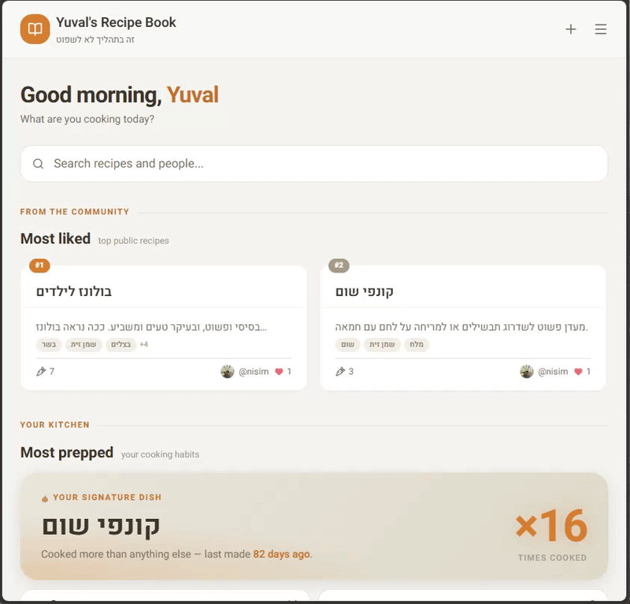

# Yuval's Recipe Book

A personal cookbook you can use from the web or from Telegram. Paste a link to any recipe page, and AI turns it into a clean recipe you can save, cook from and share.

**[Open the web app →](https://babrecipebook.vercel.app)**

## Features

- **Import from a link.** Paste a recipe URL and AI pulls out the title, ingredients and steps. It keeps the original language, Hebrew or English.
- **Import from text.** Paste a recipe as plain text and it is split into ingredients and steps for you.
- **Track your cooking.** Mark a recipe as made, see your cooking history and find out which dish you cook most.
- **Organize.** Sort recipes into your own color-coded categories.
- **Share.** Make recipes public, like other people's recipes, follow other cooks, and share any recipe with a QR code.
- **Telegram bot.** Add, edit and import recipes from a chat. It uses the same data as the website, so both always match.
- **Two languages.** The whole interface works in English and in Hebrew, including right-to-left layout.

## Technology

| Part | Tech |
|---|---|
| Web app | React 19, Vite, Tailwind CSS |
| Backend and bot | Java 23, Javalin, TelegramBots, Jsoup |
| AI | Google Gemini |
| Database and sign-in | Supabase (Postgres, Google sign-in) |
| Hosting | Vercel for the web app, Google Cloud for the backend |
| CI/CD | GitHub Actions |

The web app and the Telegram bot share one Supabase database. Users sign in with Google, and database rules make sure each person can only change their own recipes. A small Java server handles the work that has to stay on the server side, such as reading recipe pages and sending them to the AI.

Every push to `main` runs the tests first. A new backend version goes live only if they all pass.

## License

MIT
